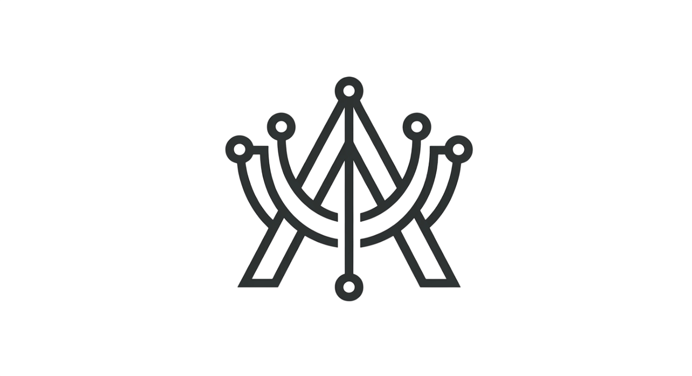

<p align="center">
  <picture>
    <source media="(prefers-color-scheme: dark)" srcset="https://raw.githubusercontent.com/anishlp7/aniui/main/docs/public/logo-dark.png" />
    <source media="(prefers-color-scheme: light)" srcset="https://raw.githubusercontent.com/anishlp7/aniui/main/docs/public/logo-light.png" />
    
  </picture>
</p>

<p align="center">
  <strong>AniUI MCP Server</strong> — give Cursor, Claude, Windsurf, and any other MCP client direct, hallucination-free access to AniUI's 150 React Native components, 15 pre-built screens, theme tokens, and SDK compatibility.
</p>

<p align="center">
  <a href="https://www.npmjs.com/package/@aniui/mcp"></a>
  
  
</p>

---

## Install

**One command** (recommended — auto-detects Cursor / Claude Desktop / Claude Code / Windsurf and writes the config for you):

```bash
npx @aniui/cli mcp install
```

**Manual** — add to your MCP client's config:

```json
{
  "mcpServers": {
    "aniui": { "command": "npx", "args": ["-y", "@aniui/mcp"] }
  }
}
```

Config locations:
- Cursor — `.cursor/mcp.json` (project)
- Claude Code — `.mcp.json` (project)
- Claude Desktop — `~/Library/Application Support/Claude/claude_desktop_config.json` (macOS) / `%APPDATA%\Claude\claude_desktop_config.json` (Windows)
- Windsurf — `~/.codeium/windsurf/mcp_config.json`

Restart the client after install.

## Tools

| Tool | Returns |
|---|---|
| `list_components` | All 150 components with name, description, tier |
| `search_components(query)` | Natural-language search, ranked by relevance |
| `get_component(name)` | Full source for one component |
| `get_component_usage(name)` | Import, variants, props, deps |
| `list_blocks` | All 15 pre-built screens |
| `get_block(name)` | Full source for one block |
| `get_theme_tokens` | HSL CSS variables + Tailwind class mappings |
| `get_theme_preset(name)` | Primary color HSLs for a named preset |
| `list_sdk_support` | Library-level compatibility matrix |
| `check_arch_compatibility(name, {expoSdk?, engine?, arch?})` | pass / warn / fail verdict with reasons |

## Resources

| URI | Purpose |
|---|---|
| `aniui://registry` | Full component registry as JSON |
| `aniui://theme` | `global.css` with every theme variable |
| `aniui://pattern` | Component authoring template + rules |

## Example

When you ask your AI *"Build me a login screen using AniUI, and make sure it works on Expo SDK 56 with Uniwind,"* here's what the MCP enables:

1. AI calls `search_components` or `list_blocks` to find `login`
2. AI calls `check_arch_compatibility("login", { expoSdk: 56, engine: "uniwind" })` — gets a `pass` verdict
3. AI calls `get_block("login")` — gets the real source
4. AI writes the screen using actual component APIs, correct imports, and a known-compatible setup

No hallucinated props. No wrong imports. No SDK mismatches.

## Also (no MCP required)

Every tool above has an HTTP fetch equivalent:

- Registry index: `https://aniui.dev/registry.json` (includes a library-level `aniui` block with `supportedSdks`, `supportedEngines`, `supportedArch`, `engineRequiresArch`)
- Per-component: `https://aniui.dev/r/{name}.json` (shadcn-spec `registry-item`, with an extra `aniui` block per item)
- Full context: `https://aniui.dev/llms-full.txt` (every component's source in one 818 KB file)

And the shadcn CLI works directly:

```bash
npx shadcn@latest add https://aniui.dev/r/login.json
```

## Links

- [AniUI docs — MCP guide](https://aniui.dev/docs/mcp)
- [AniUI docs — Shadcn registry](https://aniui.dev/docs/shadcn-registry)
- [`@aniui/cli`](https://www.npmjs.com/package/@aniui/cli)
- [GitHub](https://github.com/anishlp7/aniui)

## License

MIT
